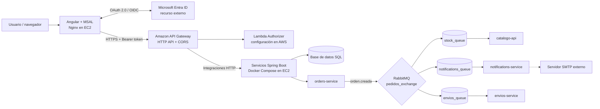

# Pedidos360

Aplicación de pedidos para estudiar arquitectura cloud y DevOps. Combina un frontend Angular, seis servicios Spring Boot, autenticación con Microsoft Entra ID, un punto de entrada en Amazon API Gateway y procesamiento asíncrono con RabbitMQ. El repositorio contiene el código y una configuración base de Docker Compose; parte de la infraestructura se administra fuera de GitHub.

> **Estado documentado: 26 de noviembre de 2026.** El flujo de compra y la recuperación de la cola de stock se probaron en la EC2 original. En la segunda EC2 funcionan tres brokers Kafka, dos nodos RabbitMQ en clúster, Kafka UI y analítica. Una acción real «Agregar al Carrito» publicó un evento Kafka que analítica consumió (`cartAdds: 1`); un evento sintético de pago elevó `paymentAttempts` y `fraudAlerts` a 1. El frontend cargó e inició sesión mediante la ruta `$default` del API Gateway; CORS devolvió `204`. El proxy de analítica respondió `200` y el WebSocket aceptó una conexión `101` y envió métricas. Falta confirmar visualmente el panel en navegador; Webpay, DynamoDB y la migración de los microservicios al RabbitMQ nuevo siguen pendientes de prueba. Consulta [avance de la evaluación](docs/AVANCE-EVALUACION.md) y [configuración AWS y `.env`](docs/CONFIGURACION-AWS-Y-ENV.md).

Para continuar el despliegue de dos instancias, sigue [la guía de dos EC2](docs/OPCION-DOS-EC2.md). La alternativa de [cambiar el tipo de la EC2 original](docs/SIGUIENTE-PASO-EC2.md) quedó bloqueada por la política del laboratorio.

## Qué hace el sistema

1. El usuario abre Angular, inicia sesión en Microsoft Entra ID y recibe tokens mediante MSAL.
2. Consulta el catálogo, administra su carrito y confirma una compra.
3. Angular envía la orden a través de API Gateway. El servicio de órdenes asigna un ID y publica un evento en RabbitMQ.
4. Tres colas independientes entregan el evento a catálogo, notificaciones y envíos. Catálogo descuenta existencias; envíos genera una guía; notificaciones intenta enviar un correo.

La respuesta HTTP `201 Created` de la compra confirma que el servicio publicó el evento y recibió la confirmación del broker. **No confirma que todos los consumidores hayan terminado**. Esa diferencia es central para entender el sistema asíncrono.

## Arquitectura



El diagrama muestra el despliegue de la demostración. Microsoft Entra ID, API Gateway y Lambda no se crean con el `docker-compose.yml`. La base de datos también cambia según el entorno: algunos archivos versionados apuntan a una instancia RDS anterior; la EC2 de la demostración usa MariaDB mediante una modificación local de Compose.

### Componentes

| Componente | Función | Código o configuración versionada |
| --- | --- | --- |
| Angular 18 + MSAL | Inicio de sesión, catálogo, carrito y compra | [`frontend/`](frontend/), [`auth-config.ts`](frontend/src/app/config/auth-config.ts) |
| `auth-api` · 8083 | Endpoint de sesión y validación de tokens de Entra ID | [`backend/auth-api/`](backend/auth-api/) |
| `catalogo-api` · 8081 | CRUD de productos y consumidor que actualiza stock | [`backend/catalogo-api/`](backend/catalogo-api/) |
| `carrito-api` · 8082 | Carrito asociado a la identidad del usuario | [`backend/carrito-api/`](backend/carrito-api/) |
| `orders-service` · 8084 | Valida la solicitud, crea ID de orden y publica el evento | [`backend/orders-service/`](backend/orders-service/) |
| `notifications-service` · 8085 | Consume la orden e intenta notificar por correo | [`backend/notifications-service/`](backend/notifications-service/) |
| `envios-service` · 8086 | Consume la orden y genera una guía de despacho | [`backend/envios-service/`](backend/envios-service/) |
| RabbitMQ | Exchange, colas y entrega de mensajes AMQP | [`RabbitMQConfig.java`](backend/orders-service/src/main/java/com/pedidos360/orders/config/RabbitMQConfig.java), [`docker-compose.yml`](docker-compose.yml) |
| API Gateway + Lambda | Rutas públicas/protegidas y autorización previa | Configuración en AWS; hay un proyecto de código fuente en [`backend/authorizer-lambda/`](backend/authorizer-lambda/) |

## Identidad y autorización: OAuth 2.0, OIDC y MSAL

**OAuth 2.0** permite que el navegador obtenga un *access token* para llamar a una API con permisos delegados. **OpenID Connect (OIDC)** agrega la identidad del usuario y el *ID token*. **MSAL Angular** es la biblioteca cliente que inicia la sesión, solicita los scopes configurados y administra los tokens. El flujo para aplicaciones de página única es código de autorización con PKCE, según la [documentación de Microsoft](https://learn.microsoft.com/en-us/entra/identity-platform/v2-oauth2-auth-code-flow).

En este proyecto, [`auth-config.ts`](frontend/src/app/config/auth-config.ts) crea `PublicClientApplication`, usa redirección para iniciar sesión, guarda la sesión en `sessionStorage` y configura `MsalInterceptor` para agregar `Authorization: Bearer <access token>` a las peticiones de las URL protegidas. [`app.routes.ts`](frontend/src/app/app.routes.ts) protege `/dashboard` con `MsalGuard` y un `roleGuard` propio. El segundo lee claims del **ID token** y deja pasar cuando no hay permisos presentes; es una ayuda de interfaz y **no una garantía de autorización**.

Las API de autenticación, catálogo y carrito contienen configuración de Spring Security para validar JWT frente a las claves públicas de Entra ID, además de issuer, audience y tiempo de validez. El *access token* es el que debe autorizar el acceso a la API; el *ID token* identifica la sesión del cliente. Las URL de redirección, identificadores de aplicación, audiencia y scopes se deben registrar de forma coherente en Entra ID y en [`frontend/src/environments/`](frontend/src/environments/). Para los conceptos de protocolo, ver [Microsoft Entra ID](https://learn.microsoft.com/en-us/entra/identity-platform/v2-protocols) y [MSAL Angular](https://learn.microsoft.com/en-us/entra/msal/javascript/angular/msal-interceptor).

### Lambda Authorizer: estado real

La API HTTP de AWS tiene un Lambda Authorizer asociado a rutas como `POST /api/v1/orders`. API Gateway toma el encabezado `Authorization`, invoca Lambda y decide si continúa hacia la integración HTTP. Se configuró respuesta simple con formato de payload `2.0`. La [documentación de AWS](https://docs.aws.amazon.com/apigateway/latest/developerguide/http-api-lambda-authorizer.html) describe ese contrato.

La fuente anterior de [`AuthorizerHandler.java`](backend/authorizer-lambda/src/main/java/com/pedidos360/authorizer/AuthorizerHandler.java) contenía comillas escapadas literales (`\"`) fuera de una cadena Java: por eso no compilaba. La versión en `main` usa comillas Java normales y Nimbus para verificar firma RS256 mediante JWKS, issuer, audience y vigencia; compiló localmente. **Esto todavía no demuestra que la Lambda desplegada en AWS use ese artefacto.** Hay que publicarlo y probar tokens válidos e inválidos. El servicio de órdenes depende de la protección de la ruta en AWS y no debe exponerse directamente sin una verificación equivalente.

## Enrutamiento en API Gateway y CORS

El frontend consume la **URL pública de API Gateway** para sus llamadas HTTP. El gateway enruta cada método y ruta, por ejemplo `POST /api/v1/orders`, a una integración HTTP que apunta al servicio correspondiente en EC2. Una ruta pública `$default` sirve Angular desde Nginx; las rutas API explícitas conservan su autorización. Se observaron `200` en `/` y `/dashboard` a través del gateway, `401` en catálogo sin token e inicio de sesión exitoso desde esa URL. El recorrido está en [API Gateway para el frontend](docs/API-GATEWAY-FRONTEND.md).

Durante la demostración se observó el gateway `d4ehy77hhb` en `us-east-1`, con `POST /api/v1/orders` integrado a `http://100.48.154.224:8084/api/v1/orders`. El frontend se sirvió desde `https://100.48.154.224`. Estos datos son del entorno de evaluación, no una garantía de disponibilidad futura; una IP pública de EC2 puede cambiar. El [`environment.prod.ts`](frontend/src/environments/environment.prod.ts) de `main` ya apunta a `d4ehy77hhb` para las API principales; la EC2 original conserva ajustes locales de Nginx/HTTPS. Al reproducir el despliegue hay que mantener una sola configuración de gateway y frontend coherente.

**CORS** es la política que permite al navegador llamar a un origen diferente. La HTTP API tiene como orígenes separados `https://100.48.154.224`, `https://d4ehy77hhb.execute-api.us-east-1.amazonaws.com` y `http://localhost:4200`; cada entrada contiene solo esquema, host y puerto opcional, sin rutas ni varias URL en un mismo campo. Los métodos incluyen `GET`, `POST`, `PUT`, `DELETE` y `OPTIONS`, y los encabezados `authorization` y `content-type`. El preflight `OPTIONS` devolvió `204` con las cabeceras esperadas. CORS **no autentica** al usuario: la autorización sigue dependiendo del token y de las verificaciones del backend/authorizer. En HTTP API, la [configuración CORS de AWS](https://docs.aws.amazon.com/apigateway/latest/developerguide/http-api-cors.html) puede responder automáticamente al preflight e ignorar las cabeceras CORS de la integración.

| Método y ruta principal | Responsable | Uso |
| --- | --- | --- |
| `GET /api/v1/auth/public/ping`, `GET /api/v1/auth/me` | `auth-api` | Estado y datos del usuario |
| `GET/POST /api/v1/catalogo/productos`, `GET/PUT/DELETE /api/v1/catalogo/productos/{id}` | `catalogo-api` | Consulta y administración del catálogo |
| `GET/DELETE /api/v1/carritos/mios`, `POST /api/v1/carritos/items`, `PUT/DELETE /api/v1/carritos/items/{itemId}` | `carrito-api` | Carrito de compra |
| `POST /api/v1/orders` | `orders-service` | Publicar una compra |
| `POST /api/v1/notifications/send` | `notifications-service` | Envío solicitado directamente |
| `GET /api/v1/envios`, `GET /api/v1/envios/{orderId}` | `envios-service` | Consultar guías en memoria |

Esta tabla enumera endpoints implementados en controladores. Una ruta visible en AWS no implica que el controlador correspondiente implemente ese método: por ejemplo, el controlador de órdenes **no** tiene `GET /api/v1/orders`; solo `POST /api/v1/orders` y `GET /api/v1/orders/ping`.

## Mensajería asíncrona con RabbitMQ

[`OrderController.java`](backend/orders-service/src/main/java/com/pedidos360/orders/controller/OrderController.java) valida que haya ítems y correo, genera `ORD-...`, publica JSON con routing key `orden.creada` en el exchange directo durable `pedidos_exchange`, marca el mensaje como persistente y espera hasta cinco segundos la confirmación del broker. [`RabbitMQConfig.java`](backend/orders-service/src/main/java/com/pedidos360/orders/config/RabbitMQConfig.java) declara tres colas durables unidas con la misma routing key. **Cada cola recibe su propia copia** del evento; el consumo de stock no vacía las otras dos.

```text
POST /api/v1/orders → orders-service → pedidos_exchange (orden.creada)
                                      ├→ stock_queue         → catalogo-api → stock SQL
                                      ├→ notifications_queue → notifications-service → correo
                                      └→ envios_queue        → envios-service → guía
```

En la prueba de recuperación se detuvo `catalogo-api`, se efectuó una compra y la consola de RabbitMQ mostró **1 mensaje Ready** en `stock_queue`. Al encender el servicio, la cola bajó a **0** y el log registró `ORD-39429633` y el nuevo stock de “Monitor 24 pulgadas” en **14 unidades**. Esto demuestra la entrega diferida en esa prueba. El consumidor de stock ejecuta la actualización dentro de una transacción y propaga los errores, evitando confirmar como exitosa una actualización fallida.

El panel de RabbitMQ está en el puerto `15672` del host de demostración (`http://100.48.154.224:15672/`), si la instancia y la regla de red están activas. `Ready` significa pendiente de entrega; `Unacked`, entregado y aún sin confirmación del consumidor. La [guía de fiabilidad de RabbitMQ](https://www.rabbitmq.com/docs/reliability) explica confirmaciones y acknowledgements.

Las colas durables y los mensajes persistentes ayudan frente a reinicios del broker, pero no sustituyen una política de respaldo. La instancia anterior usaba un volumen RabbitMQ anónimo cuya persistencia aún debe comprobarse. El código local nuevo define DLQ para stock, notificaciones y envíos y un marcador SQL para evitar doble descuento de stock por redelivery; faltan pruebas con el broker desplegado. La guía de envíos continúa en memoria y desaparece si se reinicia ese servicio. El código local de notificaciones propaga fallos SMTP para que la política DLX pueda derivarlos a la DLQ; la imagen anterior desplegada todavía no incorpora ese cambio.

## Repositorio y despliegue

```text
backend/              Seis servicios Spring Boot y proyecto del authorizer
frontend/             Aplicación Angular, configuración MSAL y Nginx
docker-compose.yml    Topología Docker base
amplify.yml           Configuración alternativa de build del frontend
postman/              Colección heredada; no cubre necesariamente las seis API
```

La demostración actual se ejecutó en **Amazon EC2** con Docker Compose: servicios Java, RabbitMQ, base de datos y frontend servido por Nginx. En AWS se configuraron por separado API Gateway, sus rutas, CORS y Lambda Authorizer. `amplify.yml` muestra una opción para compilar el frontend en Amplify, pero el frontend de la prueba se sirvió desde EC2.

La copia de EC2 tiene cambios locales de HTTPS, certificados de Nginx y `environment.prod.ts`. El código nuevo prepara MariaDB y variables en `.env.example`, pero la EC2 aún no se ha reconciliado con esta copia. Por ello, `docker compose up --build` sobre un clon nuevo todavía no reproduce automáticamente la demostración. Revisa hosts y credenciales siguiendo la [guía de configuración](docs/CONFIGURACION-AWS-Y-ENV.md). No subir claves privadas TLS, archivos `.env` reales ni contraseñas.

Para inspeccionar la versión en ejecución desde la carpeta del proyecto de la EC2:

```bash
docker compose ps
docker compose logs --since=10m orders-service catalogo-api
docker compose logs --since=10m rabbitmq
```

Para compilar el código localmente se necesitan Java 17, Maven, Node.js compatible con Angular 18 y Docker para los servicios dependientes. El frontend se construye con `npm ci --legacy-peer-deps` y `npm run build` dentro de `frontend/`. La compilación de los microservicios se realiza con Maven en cada módulo. El proyecto `authorizer-lambda` ya compiló tras corregir el defecto descrito arriba, pero su despliegue AWS sigue pendiente. Una colección Postman histórica vive en [`postman/`](postman/); conviene contrastar cada petición con los controladores y el gateway actuales.

## Qué se comprobó y qué falta

| Área | Evidencia o estado actual | Próximo trabajo |
| --- | --- | --- |
| Frontend y catálogo | Cargaron en la EC2 tras reconstruir el frontend y corregir el certificado dentro de la imagen Nginx | Documentar y versionar un despliegue reproducible sin secretos |
| API Gateway y CORS | Ruta `$default` del frontend, login desde Gateway y preflight `204` comprobados; las rutas de negocio mantienen el autorizador | Inventariar las demás rutas, integraciones y orígenes; probar con dominio estable |
| Compra y RabbitMQ | Cola de stock `Ready: 1` con catálogo detenido; `Ready: 0` y stock actualizado al reiniciarlo | Probar fallos, duplicados, persistencia del broker y colas de error |
| Seguridad | MSAL y validación JWT en tres API; authorizer configurado en AWS | Corregir, compilar y auditar Lambda; verificar firma, issuer, audience y permisos; cerrar accesos directos indebidos |
| Operación | Docker Compose en EC2 y base MariaDB configurada localmente | Variables de entorno/secretos, TLS confiable, CI, pruebas automatizadas, observabilidad y backups |
| Nueva evaluación | Kafka, pagos, analítica, WebSocket y DynamoDB codificados localmente; varias compilaciones y pruebas unitarias pasaron | Desplegar infraestructura, probar integración completa y documentar evidencia según [avance](docs/AVANCE-EVALUACION.md) |

Este README separa **código versionado**, **configuración externa observada** y **trabajo pendiente**. El objetivo es que el proyecto sirva tanto para explicar el flujo en una evaluación como para presentar un portafolio técnico verificable, sin atribuir al repositorio capacidades que todavía dependen de una configuración manual o de una prueba no realizada.
